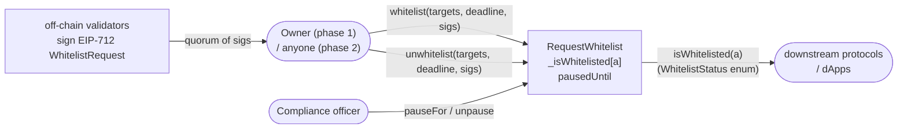

# 3f Request Whitelist

An on-chain attestation registry. A quorum of signing validators attests that
an address is authored by this registry's operator; consumers call
`isWhitelisted(address)` as the single source of truth. A compliance role can
freeze the registry as a circuit breaker; while paused, `isWhitelisted` never
returns the trusted `Whitelisted` value, but validator / quorum / compliance
rotation paths remain reachable so the breaker cannot strand the recovery
it was built to enable.

The contract is factory- and proxy-agnostic: deploy the implementation once,
put it behind any ERC-1967 proxy, and call `initialize` through the proxy.

## How it works



`whitelist` is owner-gated in Phase 1 but open to any submitter in Phase 2;
`unwhitelist` is never owner-gated, so a valid quorum can revoke an
attestation regardless of phase (fail-safe: attestations must always be
revocable).

### Key invariants

Every property below holds across every reachable state transition. The
A/B/C/D/E grouping is reused in the invariant test harness so a failing
run points straight at the clause that broke.

**A. Validator set & quorum structure**

- **A1.** `1 <= quorum < validators.length <= MAX_VALIDATORS` (256). The
  strict inequality between `quorum` and `validators.length` guarantees
  that no quorum-sized coalition can brick or fully capture the registry
  by shrinking the set down to its own membership.
- **A2.** The validator set never contains duplicates and never contains
  `address(0)`. `_addValidator` rejects both; the set itself is a
  solady `EnumerableSetLib.AddressSet` so duplicates are structurally
  impossible.
- **A3.** The three public views over the validator set
  (`validators()`, `validatorAt(i)`, `isValidator(a)`) agree on every
  element. `validatorsLength()` equals `validators().length`.

**B. Nonce discipline**

- **B1.** `validatorNonceFloor[v]` is monotonically non-decreasing.
  `setValidatorNonce` is strict-increase; `_removeValidator` and
  `revokeAllRoles` saturate to `type(uint256).max`; no other writer
  exists.
- **B2.** Once a validator has ever been removed, their nonce floor is
  `type(uint256).max` forever — even if the same address is later
  re-added. Combined with the bitmap's permanent-set property this
  closes the re-add replay window: no signature the retired address
  ever produced can pass `NonceBelowFloor` again.
- **B3.** Each validator signature carries a signer-chosen nonce. The
  nonce is recorded in a per-validator bitmap on successful verify and
  permanently single-use — a bit set to `1` never returns to `0`. Sigs
  at any unused nonce at or above the validator's current floor can be
  submitted **in any order**.

**C. Pause state machine**

- **C1.** `pausedUntil` moves forward via `pauseFor` (extend-only,
  reverts `PauseNotExtended` on any call that wouldn't strictly extend
  the current window) and drops to `0` via `unpause`. It never shrinks
  to a non-zero value.
- **C2.** `isPaused()` is a pure function of `pausedUntil` and
  `block.timestamp` — no cached pause state anywhere.
- **C3.** While paused, `whitelist` and `unwhitelist` revert with
  `ContractPaused`. Compliance `pauseFor` / `unpause` and every
  rotation path (`setValidatorNonce`, all `*BySig` admin functions)
  remain reachable — the circuit breaker exists to buy the quorum time
  to rotate, not to freeze rotation itself.

**D. `isWhitelisted` semantics**

- **D1.** While paused, `isWhitelisted(a)` never returns
  `Whitelisted` or `NotWhitelisted` — the return is always one of the
  `Paused*` variants, regardless of the underlying attestation bit.
- **D2.** While live (not paused), `isWhitelisted(a)` returns exactly
  one of `Whitelisted` / `NotWhitelisted`, matching the `_isWhitelisted`
  bit.

**E. Ownership irreversibility**

- **E1.** Once `owner()` becomes `address(0)`, it stays there.
  `renounceOwnership()` is the only writer to zero and has no inverse;
  the Phase-1 admin surface cannot be re-opened after handover to the
  validator quorum.

### Return-value enum

`isWhitelisted` returns a four-way `WhitelistStatus`:

| Value | Meaning | Consumer action |
|---|---|---|
| `NotWhitelisted` | live registry, never attested or revoked | do not authorise |
| `Whitelisted` | live registry, currently attested | authorise |
| `PausedNotWhitelisted` | paused, not attested at pause time | do not authorise |
| `PausedWhitelisted` | paused, was attested before the pause | do not authorise, but can be surfaced as "temporarily gated" rather than "never listed" |

Only `Whitelisted` is safe to trust; every other value should be treated as
"do not authorise". The richer enum lets integrators distinguish
"permanently not listed" from "circuit breaker active" when surfacing the
state to end users.

### Two-phase admin surface

The contract is designed to start under an owner and later transition to
pure quorum-governed operation:

| Phase | `owner()` | Admin path | `whitelist` submitter |
|---|---|---|---|
| Owned (bootstrap) | EOA / multisig | `addValidator`, `removeValidator`, `setQuorum`, `setComplianceOfficer`, `revokeAllRoles` — `onlyOwner` | only the owner |
| Renounced (steady state) | `address(0)` | `*BySig` twins of each admin action — gated by a quorum of validator sigs + `_requireRenounced` | anyone holding valid sigs |

Calling `renounceOwnership()` is irreversible; after that point, every admin
mutation must be authorized by a validator quorum and anyone can submit.

`revokeAllRoles(a)` is an owner-only incident-response tool: it strips the
validator role and the compliance flag from `a` in a single transaction,
which matters because the two roles are orthogonal mappings — removing
someone as a validator does not strip their compliance flag, and vice
versa. Post-renounce, the equivalent is
`removeValidatorBySig(a, ...)` followed by
`setComplianceOfficerBySig(a, false, ...)`.

### Signature scheme

All sigs are EIP-712 typed data signed over `(name: "3fRequestWhitelist",
version: "1", chainId, verifyingContract)`. Three typehashes:

- `WhitelistRequest(address[] targets, uint256 deadline, address validator, uint256 nonce)`
- `UnwhitelistRequest(address[] targets, uint256 deadline, address validator, uint256 nonce)`
- `AdminRequest(bytes32 actionId, bytes data, uint256 deadline, address validator, uint256 nonce)`

Both ECDSA (EOA) and ERC-1271 (contract) signers are accepted transparently
via solady's `SignatureCheckerLib`. A single per-validator index bitmap
de-duplicates signers within a call — the `MAX_VALIDATORS = 256` cap is
dictated by this dedup word.

#### Nonce model (bitmap + floor)

Two pieces of per-validator state guard replay:

- `validatorNonceBitmap[v][word]` — a packed 256-bit word per 256-nonce
  range. Bit `n & 0xff` of word `n >> 8` is set on successful verify of
  a sig at nonce `n`. Any attempt to consume an already-set bit reverts
  `NonceConsumed`. Because the bitmap records consumption by position
  rather than by sequence, sigs can be submitted in **any order** —
  there is no "expected next nonce" and therefore no out-of-order
  relayer race.
- `validatorNonceFloor[v]` — a single scalar below which every sig is
  rejected `NonceBelowFloor`. This is the **mass-invalidate lever**.
  The validator raises it themselves via `setValidatorNonce(newFloor)`
  (one SSTORE, no per-sig bookkeeping). The floor is strict-increase:
  it cannot be lowered once raised. Removal of a validator saturates
  the floor to `type(uint256).max`, which permanently retires that
  address from ever signing again — combined with the strict-increase
  rule, a removed validator cannot be re-admitted at the same address
  with a lower floor, so any pre-signed sig at any reasonable nonce is
  unusable after removal (closes the re-add replay window).

Validators are free to allocate nonces sequentially (simplest),
time-based, random, or sparse — only the "not below floor, not already
consumed" rule is enforced. The suggested default for operators is
sequential from 0, since that minimises bitmap storage cost: only the
words actually touched by consumed nonces are written to.

`setValidatorNonce(newFloor)` remains reachable while the registry is
paused. Pausing *is* the signal that something is wrong, so the
mass-invalidate lever must be usable under pause.

#### Trust model for ERC-1271 signers

`SignatureCheckerLib.isValidSignatureNowCalldata` forwards the full
remaining gas to the signer contract's `isValidSignature` staticcall.
Solady caps the return-data copy at 32 bytes (no return-bomb surface),
but a malicious or buggy ERC-1271 signer can still burn up to ~63/64 of
remaining gas and return `0`, causing the enclosing batch to revert
after the submitter has paid near-block-gas-limit execution cost.

**Operational requirement**: every contract admitted as a validator must
be vetted. Only admit ERC-1271 signers whose `isValidSignature`
implementation is known, auditable, and bounded in gas — multisigs with
simple recovery logic are safe; arbitrary proxy or plugin-style signers
are not.

#### Relayer considerations

Because the bitmap accepts any unconsumed nonce at or above the floor,
the relayer-ordering races that a strict-sequential nonce model would
produce are absent:

- **Any submission order works**: a batch signed at nonce 7 and a batch
  signed at nonce 3 can be submitted in either order; each consumes
  its own bit independently.
- **Same-nonce collision**: if two distinct batches accidentally share
  a nonce from the same validator (e.g. because the signer's off-chain
  counter raced), the first to mine consumes; the second reverts
  `NonceConsumed` and must be re-signed at a fresh nonce. This is the
  only residual race and it is self-announcing.
- **Nonce burn by quorum**: a quorum-sized coalition can still consume
  arbitrary bits in validators' bitmaps by producing quorum-signed
  admin actions at those nonces, but each such burn costs a real
  signature per validator per bit, and the strict
  `quorum < validators.length` invariant means at least one
  non-coalition validator must have pre-signed at the burned nonce for
  the burn to consume a *useful* bit. Operational impact is minor
  (off-chain counters can skip burned bits), not a protocol break.

Validators managing many in-flight sigs can simply maintain a local
incrementing counter; the protocol has no sequencing requirement.

### Storage layout

All mutable state lives in a single ERC-7201 namespaced struct at
`keccak256(abi.encode(uint256(keccak256("3f.storage.RequestWhitelist")) - 1)) & ~bytes32(uint256(0xff))`.
`Ownable` and `Initializable` use solady's hardcoded high-slot constants,
which cannot collide.

**Storage upgrade rule (append-only)**: future versions must never
reorder, resize, or remove fields in `Layout`. Slot 0's packing of
`uint16 quorum` + `uint48 pausedUntil` leaves 26 bytes for forward-
compatible flags and must not be rearranged. Dynamic members (the
validator set and the mappings) each anchor their own base slot, so
appending additional dynamic fields after the existing members is
safe.

### Proxy & upgrades

- **Recommended proxy**: solady's `ERC1967Factory`. Use
  `factory.deployAndCall(impl, admin, initCalldata)` so the proxy is
  deployed and `initialize`d atomically — this closes the one-shot
  front-running window on `initialize`. A separate EOA-less
  deployment followed by a second `initialize` tx is discouraged; if
  used, the operator must accept the front-run risk.
- **Proxy admin is not `owner()`**. The ERC-1967 admin slot controls
  upgrades and is set at deploy time (the `proxyAdmin` parameter to
  `deployAndCall`); the application-level `owner()` role controls
  Phase-1 admin mutations. Keep the two roles separate.
- **Upgrade policy**: out of scope for this contract; the proxy admin
  controls upgrades at the ERC-1967 layer. Operators deploying for
  production should decide explicitly whether upgrades are gated by
  a timelock, renounced after a settling period, or locked behind a
  governance contract — and document that decision alongside the
  deployment.

## Layout

```
src/
  RequestWhitelist.sol      -- the registry
  IWhitelist.sol            -- minimal read interface for consumers
  lib/
    QuorumSigLib.sol        -- EIP-712 / EIP-1271 quorum verification
    WhitelistEvents.sol     -- every event declared here
    WhitelistErrors.sol     -- every contract-level revert declared here
test/
  RequestWhitelist.t.sol    -- full suite
  mocks/MockERC1271.sol
```

## Usage

```shell
# build
forge build

# run the test suite
forge test

# format
forge fmt
```

Deployment is proxy-based and **must** be atomic to close the one-shot
`initialize` front-run window:

1. Deploy `RequestWhitelist` (implementation). Its constructor calls
   `_disableInitializers()` so it can never be initialized directly.
2. Deploy the proxy **and** call `initialize` in a single transaction via
   `ERC1967Factory.deployAndCall(impl, proxyAdmin, initData)` where
   `initData = abi.encodeCall(RequestWhitelist.initialize, (owner, validators, quorum, complianceOfficers))`.
   Do not deploy the proxy and call `initialize` in separate
   transactions — anyone watching the mempool can front-run the second
   call and burn the proxy.
3. Consumers import `IWhitelist`, call `isWhitelisted(address)` on the
   proxy address, and gate strictly on
   `status == IWhitelist.WhitelistStatus.Whitelisted`.
