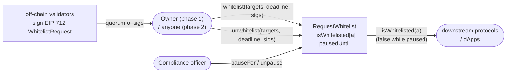

# 3f Request Whitelist

An on-chain attestation registry. A quorum of signing validators attests that
an address is authored by this registry's operator; consumers call
`isWhitelisted(address)` as the single source of truth. A compliance role can
freeze the registry for a bounded window as a circuit breaker.

The contract is factory- and proxy-agnostic: deploy the implementation once,
put it behind any ERC-1967 proxy, and call `initialize` through the proxy.

## How it works



### Key invariants

- `quorum ≤ validators.length ≤ MAX_VALIDATORS` (256).
- Each validator signature carries the signer's current on-chain nonce and
  is **consumed on use** — the nonce advances by one on a successful verify,
  so the same sig can never be replayed.
- `isWhitelisted(a)` returns `false` for every address while
  `block.timestamp < pausedUntil`, regardless of underlying storage.
- While paused, every state-changing call reverts with `ContractPaused`
  except `pauseFor` (extend) and `unpause` (cancel), both callable only by
  compliance officers.

### Two-phase admin surface

The contract is designed to start under an owner and later transition to
pure quorum-governed operation:

| Phase | `owner()` | Admin path | `whitelist` submitter |
|---|---|---|---|
| Owned (bootstrap) | EOA / multisig | `addValidator`, `removeValidator`, `setQuorum`, `setComplianceOfficer` — `onlyOwner` | only the owner |
| Renounced (steady state) | `address(0)` | `*BySig` twins of each admin action — gated by a quorum of validator sigs + `_requireRenounced` | anyone holding valid sigs |

Calling `renounceOwnership()` is irreversible; after that point, every admin
mutation must be authorized by a validator quorum and anyone can submit.

### Signature scheme

All sigs are EIP-712 typed data signed over `(name: "3fRequestWhitelist",
version: "1", chainId, verifyingContract)`. Three typehashes:

- `WhitelistRequest(address[] targets, uint256 deadline, address validator, uint256 nonce)`
- `UnwhitelistRequest(address[] targets, uint256 deadline, address validator, uint256 nonce)`
- `AdminRequest(bytes32 actionId, bytes data, uint256 deadline, address validator, uint256 nonce)`

Both ECDSA (EOA) and ERC-1271 (contract) signers are accepted transparently
via solady's `SignatureCheckerLib`. A single per-validator index bitmap
de-duplicates signers within a call — the `MAX_VALIDATORS = 256` cap is
dictated by this dedup word.

A validator can bump their own nonce via `setValidatorNonce(newNonce)` to
mass-invalidate every outstanding sig they produced, e.g. on key suspicion.

### Storage layout

All mutable state lives in a single ERC-7201 namespaced struct at
`keccak256(abi.encode(uint256(keccak256("3f.storage.RequestWhitelist")) - 1)) & ~bytes32(uint256(0xff))`.
`Ownable` and `Initializable` use solady's hardcoded high-slot constants,
which cannot collide.

## Layout

```
src/
  RequestWhitelist.sol      -- the registry
  IWhitelist.sol            -- minimal read interface for consumers
  lib/
    QuorumSigLib.sol        -- EIP-712 / EIP-1271 quorum verification
    WhitelistEvents.sol     -- every event declared here
    WhitelistErrors.sol     -- every contract-level revert declared here
test/
  RequestWhitelist.t.sol    -- full suite (54 tests)
  mocks/MockERC1271.sol
```

## Usage

```shell
# build
forge build

# run the test suite
forge test

# format
forge fmt
```

Deployment is proxy-based:

1. Deploy `RequestWhitelist` (implementation). Its constructor calls
   `_disableInitializers()` so it can never be initialized directly.
2. Deploy any ERC-1967 proxy (e.g. solady's `ERC1967Factory`) pointing at
   the implementation, with calldata
   `abi.encodeCall(RequestWhitelist.initialize, (owner, validators, quorum, complianceOfficers))`.
3. Consumers import `IWhitelist` and call `isWhitelisted(address)` on the
   proxy address.
